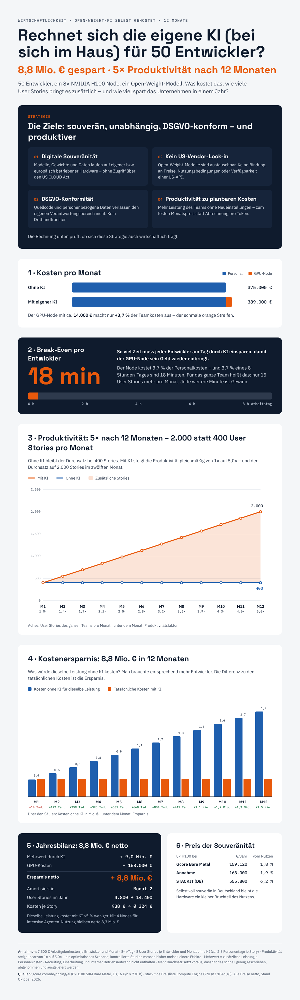

# Rechnet sich die eigene KI für 50 Entwickler?

Wirtschaftlichkeit von selbst gehosteten Open-Weight-Modellen auf eigener GPU-Hardware – am Beispiel eines Entwicklerteams mit 50 Personen und eines 8× NVIDIA H100 Nodes bei einem europäischen Anbieter.

## Strategie und Ziele

Bevor gerechnet wird: Warum überhaupt eine eigene KI? Die Strategie verfolgt vier Ziele.

1. **Digitale Souveränität:** Modelle, Gewichte und Daten laufen auf eigener bzw. europäisch betriebener Hardware, die das Unternehmen kontrolliert. Bei einem europäischen Anbieter ohne US-Mutterkonzern greift der US CLOUD Act nicht.
2. **Kein US-Vendor-Lock-in:** Open-Weight-Modelle lassen sich austauschen, ohne Verträge oder Schnittstellen zu wechseln. Keine Bindung an Preise, Nutzungsbedingungen oder Verfügbarkeit einer US-API. Die Abhängigkeit von NVIDIA-Hardware bleibt.
3. **DSGVO-Konformität:** Quellcode und personenbezogene Daten verlassen den eigenen Verantwortungsbereich nicht. Das vereinfacht Auftragsverarbeitung und vermeidet Drittlandtransfer; technische und organisatorische Maßnahmen bleiben trotzdem nötig.
4. **Produktivität zu planbaren Kosten:** Mehr Leistung des Teams ohne Neueinstellungen – zum festen Monatspreis statt Abrechnung pro Token.

Die folgende Rechnung prüft, ob sich diese Strategie auch wirtschaftlich trägt.

**Infografik:** [PNG](bilder/infografik-ki-rentabilitaet.png) · [PNG @2x](bilder/infografik-ki-rentabilitaet@2x.png) · [PDF](bilder/infografik-ki-rentabilitaet.pdf) · [Quelle (Design-Datei)](quelle/infografik.dc.html)

## Kernergebnisse

| Kennzahl | Wert |
|---|---|
| Personalkosten Team (50 Entwickler) | 375.000 € / Monat |
| GPU-Node 8× H100 | ca. 14.000 € / Monat (3,7 % der Personalkosten) |
| Break-Even | 18 Minuten Zeitersparnis pro Entwickler und Tag |
| Break-Even in User Stories | 15 zusätzliche Stories pro Monat im Team |
| Szenario 1× → 5× in 12 Monaten | 8,8 Mio. € Ersparnis netto, amortisiert in Monat 2 |

## 1. Infrastruktur und Kosten

Ein 8× H100 Node ist mit 640 GB GPU-Speicher groß genug, um leistungsfähige Open-Weight-Modelle für ein ganzes Entwicklerteam zu betreiben.

Öffentlich einsehbare Preise (netto, Stand Oktober 2026):

| Anbieter | Angebot | Preis | pro Monat (730 h) |
|---|---|---|---|
| [Gcore](https://gcore.com/de/pricing/ai) | 8× H100 SXM Bare Metal, 2 TB RAM, 3,2 Tbit/s InfiniBand | 18,16 €/h | ca. 13.260 € |
| [STACKIT](https://stackit.de/en/?p=44023399) | n3.104d.g8, 8× HGX H100, deutsche Rechenzentren | 64,33 €/h | ca. 46.320 € |

Die Annahme von **14.000 € pro Monat** ist damit durch einen Marktpreis belegt. Gcore hat seinen Sitz in Luxemburg; der Rechenzentrumsstandort ist bei der Bestellung zu wählen. STACKIT steht für die Variante mit voller deutscher Souveränität und kostet etwa das 3,3-Fache.

## 2. Kosten im Verhältnis

| | pro Monat | pro Jahr |
|---|---|---|
| Personal (50 × 7.500 € Arbeitgeberkosten) | 375.000 € | 4,5 Mio. € |
| GPU-Node | 14.000 € | 168.000 € |
| **Anteil GPU an Personalkosten** | **3,7 %** | **3,7 %** |

Ein Jahr eigene KI-Infrastruktur kostet weniger als zwei Entwicklergehälter.

## 3. Break-Even

Der Node kostet 3,7 % der Personalkosten. 3,7 % eines 8-Stunden-Tages (480 Minuten) sind **18 Minuten**. Spart jeder Entwickler so viel Zeit pro Tag, ist der Node bezahlt; jede weitere Minute ist Gewinn.

Wer statt 8 nur 6,25 produktive Stunden pro Tag ansetzt, kommt auf rund 14 Minuten.

| Anbieter | Kosten / Jahr | Break-Even pro Entwickler und Tag |
|---|---|---|
| Gcore | 159.120 € | ca. 17 min |
| Annahme | 168.000 € | ca. 18 min |
| STACKIT | 555.800 € | ca. 59 min |

## 4. Szenario: Produktivität steigt in 12 Monaten von 1× auf 5×

Annahme: Die Produktivität wächst linear vom ersten bis zum zwölften Monat. Eine User Story kostet ohne KI 2,5 Personentage, also 8 Stories pro Entwickler und Monat (400 im Team).

| Monat | Faktor | Stories | Ersparnis im Monat | kumuliert |
|---|---|---|---|---|
| M1 | 1,0× | 400 | −14.000 € | −14.000 € |
| M2 | 1,4× | 545 | 122.364 € | 108.364 € |
| M3 | 1,7× | 691 | 258.727 € | 367.091 € |
| M4 | 2,1× | 836 | 395.091 € | 762.182 € |
| M5 | 2,5× | 982 | 531.455 € | 1,29 Mio. € |
| M6 | 2,8× | 1.127 | 667.818 € | 1,96 Mio. € |
| M7 | 3,2× | 1.273 | 804.182 € | 2,77 Mio. € |
| M8 | 3,5× | 1.418 | 940.545 € | 3,71 Mio. € |
| M9 | 3,9× | 1.564 | 1,08 Mio. € | 4,78 Mio. € |
| M10 | 4,3× | 1.709 | 1,21 Mio. € | 6,00 Mio. € |
| M11 | 4,6× | 1.855 | 1,35 Mio. € | 7,35 Mio. € |
| M12 | 5,0× | 2.000 | 1,49 Mio. € | 8,83 Mio. € |

Die Ersparnis ist das, was dieselbe Leistung ohne KI zusätzlich an Personal kosten würde, abzüglich der GPU-Kosten.

### Jahresbilanz

| Kennzahl | Wert |
|---|---|
| Mehrwert durch KI | 9,0 Mio. € |
| GPU-Kosten | − 168.000 € |
| **Ersparnis netto** | **8,8 Mio. €** |
| Amortisiert in | Monat 2 |
| User Stories im Jahr | 4.800 → 14.400 (+ 9.600) |
| Kosten je Story | 938 € → Ø 324 € (195 € in M12) |
| Mit 4 Nodes (672.000 € / Jahr) | 8,3 Mio. € netto |

## 5. Einordnung und Grenzen

- **5× ist optimistisch.** Kontrollierte Studien messen bisher meist deutlich kleinere Effekte. Das Szenario zeigt die Obergrenze; schon 30 bis 60 Minuten pro Tag machen die Hardware rentabel.
- **Ein Node kann zum Engpass werden.** Intensive agentische Nutzung braucht eher 2 bis 4 Nodes. Am Ergebnis ändert das wenig.
- **Nicht enthalten:** interner Betriebsaufwand (Modell-Updates, Monitoring, Inferenz-Stack), Anlaufphase, Recruiting und Einarbeitung. Mit 0,5 Stellen Betriebsaufwand steigt der Break-Even auf rund 23 Minuten.
- **Der Engpass wandert.** Mehr Durchsatz setzt voraus, dass User Stories schnell genug geschrieben, abgenommen und ausgeliefert werden.

## Quellen

- [Gcore GPU-Cloud-Preise](https://gcore.com/de/pricing/ai)
- [STACKIT Compute Engine GPU – Preise](https://stackit.de/en/?p=44023399)
- [STACKIT Leistungsschein Compute Engine GPU](https://www.stackit.de/de/agb/leistungsscheine/stackit-compute-engine-gpu)
