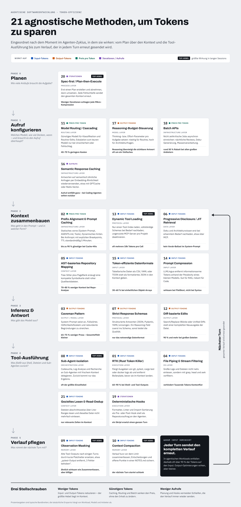

# Agnostische Methoden zur Token-Einsparung bei KI-Agenten

Alle Methoden sind herstellerunabhängig: Sie funktionieren mit Claude, GPT, Gemini und jedem gängigen Agenten-Framework.

## Die 7 Kernmethoden im Effizienz-Ranking

### 1. RTK (Rust Token Killer) – Input/Execution Layer
- **Funktionsweise:** Fängt Ausgaben von Shell-Befehlen (`git status`, `pytest`, `cargo test`, `docker logs`) auf Betriebssystemebene ab und reduziert Boilerplate-Müll.
- **Ersparnis:** 60 % – 90 % bei Shell-/Tool-Outputs.
- **Agnostisch weil:** Läuft als unabhängiges Rust-Binary transparent in der OS-Environment.

### 2. Prompt Prefix Alignment & Server Caching – Infrastructure Layer
- **Funktionsweise:** Exakte Trennung in unveränderliche statische Präfixe (`AGENTS.md`, System-Prompts, geladene Dateien) am Anfang und dynamische Prompts am Ende des Kontexts.
- **Ersparnis:** Bis zu 90 % Kosten- und Latenzreduktion bei Cache-Hits.
- **Agnostisch weil:** Nutzt den Prefix-Matching-Mechanismus aller führenden LLM-Provider (Anthropic, OpenAI, Google).

### 3. Caveman Pattern – Output/Model Layer
- **Funktionsweise:** System-Prompts / Skills weisen das Modell an, Füllwörter, Höflichkeitsfloskeln und redundante Begründungen zu streichen.
- **Ersparnis:** 65 % – 75 % weniger teure Output-Tokens.
- **Agnostisch weil:** Kann in jedem Agenten-Framework via System-Prompt oder `AGENTS.md` hinterlegt werden.

### 4. Direct File Piping & Stream Filtering – OS Layer
- **Funktionsweise:** Anweisung an den Agenten, große Logs oder Dateien nicht nativ einzulesen, sondern CLI-Pipelines (`grep`, `head`, `awk`) zu nutzen.
- **Ersparnis:** Verhindert das Überfluten des Kontextfensters um Tausende Tokens.
- **Agnostisch weil:** Basiert rein auf Standard-Shell-Befehlen.

### 5. AST-basiertes Repository Mapping – Context Layer
- **Funktionsweise:** Erzeugt über Tree-Sitter und Algorithmen (z. B. PageRank) eine kompakte Symbolkarte des Projekts anstelle roher Quellcodedateien.
- **Ersparnis:** 70 % – 80 % Kontextreduktion bei der Repositoriumsanalyse.
- **Agnostisch weil:** Wird als eigenständiges Skript vor dem Agenten-Call ausgeführt.

### 6. Progressive Disclosure / JIT Retrieval – Data Layer
- **Funktionsweise:** Dokumente und Architektur-Wissen werden erst Just-in-Time bei explizit erkannten Abfragebedarfen nachgeladen.
- **Ersparnis:** Vermeidet unnötige Pre-Inference-Payloads im System-Prompt.
- **Agnostisch weil:** Basiert auf herstellerneutralen Protokollen wie dem Model Context Protocol (MCP).

### 7. Strict Response Schemas – Protocol Layer
- **Funktionsweise:** Erzwingen von strukturierten Antworten (JSON, Pydantic, YAML) für Funktionsaufrufe, um Prosa vollständig zu eliminieren.
- **Ersparnis:** Minimiert Output-Tokens auf das absolut notwendige Daten-Format.
- **Agnostisch weil:** Standard-Funktion moderner LLM-APIs.

## Weitere agnostische Methoden

### 8. Sub-Agent-Isolation / Context Firewall – Orchestration Layer
Explorative Arbeit wie Codesuche, Log-Analyse oder Recherche wird an Sub-Agenten mit frischem Kontext delegiert. Diese geben nur das Ergebnis zurück, nicht die gelesenen Rohdaten. Der Hauptkontext bleibt schlank.
**Ersparnis:** Oft der größte Einzelhebel bei langen Sessions, weil Tausende Tokens Suchmüll nie in den Hauptverlauf gelangen.

### 9. Observation Masking / Tool-Result-Clearing – Memory Layer
Alte Tool-Outputs werden nach einigen Turns aus dem Verlauf entfernt oder durch Platzhalter ersetzt, etwa „[Output von `pytest` entfernt, 3 Fehler behoben]“. Untersuchungen zu SWE-Agenten zeigen, dass simples Masking ähnlich gut abschneidet wie LLM-Zusammenfassung, aber billiger ist.

### 10. Context Compaction / Rolling Summarization – Memory Layer
Kurz vor dem Kontextlimit wird der Verlauf zusammengefasst. Erhalten bleiben Entscheidungen, offene Punkte und geänderte Dateien; der Rohverlauf wird verworfen. Variante: ein persistentes `NOTES.md` oder `PROGRESS.md`, das der Agent selbst pflegt und nach einem Reset neu einliest.

### 11. Model Routing / Cascading – Routing Layer
Ein günstiges Modell übernimmt Klassifikation, Zusammenfassung und einfache Edits. Erst bei Unsicherheit oder Fehlschlag wird an das teure Modell eskaliert (z. B. über LiteLLM, RouteLLM oder eigene Router).
**Ersparnis:** Keine Token-, sondern eine Kostenreduktion, oft um 40–70 %.

### 12. Diff-basierte Edits statt Full-File-Rewrite – Output Layer
Der Agent erzeugt Search/Replace-Blöcke oder Unified Diffs, statt eine Datei komplett neu auszugeben. Bei großen Dateien spart das 90 % und mehr der Output-Tokens für die jeweilige Änderung.

### 13. Dynamic Tool Loading / Tool-Schema-Pruning – Protocol Layer
Tool-Definitionen, besonders aus vielen MCP-Servern, kosten bei jedem Call Input-Tokens und summieren sich oft auf mehrere 10k Tokens. Abhilfe: nur einen Tool-Index laden und die vollständigen Schemas per Suche nachladen; nicht benötigte MCP-Server pro Projekt deaktivieren.

### 14. Prompt Compression – Input Layer
Tools wie LLMLingua oder LongLLMLingua entfernen informationsarme Tokens anhand der Perplexity eines kleinen Modells. Gut für RAG-Kontexte und Dokumente, riskant für Code, weil Syntax bricht.

### 15. Token-effiziente Datenformate – Input Layer
Tabellarische Daten als CSV, YAML oder TOON statt als formatiertes JSON in den Kontext geben. Bei einheitlichen Objekt-Arrays spart das 30–60 %. JSON-Pretty-Printing ist besonders teuer, weil Einrückung und wiederholte Keys viele Tokens kosten.

### 16. Semantic Response Caching – Infrastructure Layer
Antworten auf semantisch ähnliche Anfragen werden über Embedding-Ähnlichkeit wiederverwendet (z. B. GPTCache, Redis Vector). Lohnt sich für wiederkehrende Fragen, ist für Coding-Agenten aber kaum relevant.

### 17. Reasoning-Budget-Steuerung – Model Layer
Thinking- bzw. Effort-Parameter pro Aufgabe setzen: niedrig für Routine, hoch für Architekturfragen. Reasoning-Tokens werden als Output abgerechnet und übersteigen die sichtbare Antwort oft um ein Vielfaches.

### 18. Batch APIs – Infrastructure Layer
Für nicht zeitkritische Jobs gibt es bei allen großen Anbietern rund 50 % Rabatt, etwa für nächtliche Code-Reviews, Doku-Generierung oder seitenweise Textverarbeitung.

### 19. Deterministische Hooks statt LLM-Arbeit – Execution Layer
Formatter, Linter und Import-Sortierung laufen als Pre- oder Post-Hooks, statt den Agenten das „reparieren“ zu lassen. Jede Aufgabe, die ein Skript deterministisch lösen kann, sollte kein LLM-Turn sein.

### 20. Spec-first / Plan-then-Execute – Process Layer
Erst einen Plan erstellen und abnehmen, dann umsetzen. Der eigentliche Kostentreiber bei Agenten sind Fehlversuchs-Schleifen, weil jede Iteration den gesamten Kontext erneut sendet. Weniger Iterationen bringen mehr als jede Mikro-Kompression.

### 21. Gezieltes Lesen mit Line-Ranges und Read-Deduplizierung – Context Layer
Der Agent liest Dateien abschnittsweise (`offset`/`limit`, `sed -n`) und liest dieselbe Datei nicht mehrfach ein. Verwandt mit Methode 4, betrifft aber den nativen Read statt der Shell.

## Anmerkungen zu den Kernmethoden

- **#2 Caching:** Nicht bei allen Anbietern automatisch. OpenAI cached ab etwa 1024 Tokens automatisch; bei Anthropic sind explizite `cache_control`-Breakpoints nötig, außer Harnesses wie Claude Code setzen sie. Cache-Writes kosten dort einen Aufschlag, der Standard-TTL beträgt nur 5 Minuten. Tool-Definitionen gehören zum Präfix – eine Änderung an den MCP-Tools invalidiert den Cache.
- **#3 Caveman:** Die Prozentzahl bezieht sich auf die Prosa-Ausgabe. In agentischen Workloads machen Input-Tokens oft über 90 % der Gesamtmenge aus, weil der Verlauf in jedem Turn erneut gesendet wird. Der Gesamteffekt ist daher deutlich kleiner; aggressive Kürze kann außerdem die Qualität senken.
- **#7 Strict Schemas:** Constrained Decoding kann die Reasoning-Qualität mindern. Bewährt: ein `reasoning`-Feld als erstes Schema-Feld oder Thinking vor die strukturierte Ausgabe legen.

## Priorisierung

Der Hebel liegt fast immer beim Input-Kontext – also bei den Methoden 8, 9, 10, 13 und 20 – und nicht beim Output. Für eine Einordnung lassen sich die Methoden zusätzlich danach ordnen, was sie reduzieren:

| Stellschraube | Methoden |
|---|---|
| Anzahl Tokens | 1, 3, 4, 5, 6, 7, 8, 9, 10, 12, 13, 14, 15, 17, 21 |
| Kosten pro Token | 2, 11, 16, 18 |
| Anzahl Iterationen | 19, 20 |
