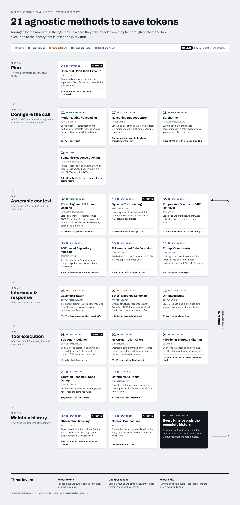

# Agnostic Methods for Saving Tokens with AI Agents

🇩🇪 [Deutsche Version](methoden.md)

All methods are vendor-agnostic: they work with Claude, GPT, Gemini and every common agent framework.

## The 7 core methods, ranked by efficiency

### 1. RTK (Rust Token Killer) – Input/Execution Layer
- **How it works:** Intercepts the output of shell commands (`git status`, `pytest`, `cargo test`, `docker logs`) at the OS level and strips boilerplate noise.
- **Savings:** 60 % – 90 % on shell and tool output.
- **Agnostic because:** Runs as a standalone Rust binary, transparently in the OS environment.

### 2. Prompt Prefix Alignment & Server Caching – Infrastructure Layer
- **How it works:** Strict separation into immutable static prefixes (`AGENTS.md`, system prompts, loaded files) at the start and dynamic prompts at the end of the context.
- **Savings:** Up to 90 % lower cost and latency on cache hits.
- **Agnostic because:** Uses the prefix-matching mechanism of all leading LLM providers (Anthropic, OpenAI, Google).

### 3. Caveman Pattern – Output/Model Layer
- **How it works:** System prompts or skills instruct the model to drop filler words, pleasantries and redundant justifications.
- **Savings:** 65 % – 75 % fewer expensive output tokens.
- **Agnostic because:** Can be set in any agent framework via system prompt or `AGENTS.md`.

### 4. Direct File Piping & Stream Filtering – OS Layer
- **How it works:** The agent is told not to read large logs or files natively, but to use CLI pipelines (`grep`, `head`, `awk`).
- **Savings:** Prevents flooding the context window with thousands of tokens.
- **Agnostic because:** Relies purely on standard shell commands.

### 5. AST-based Repository Mapping – Context Layer
- **How it works:** Uses Tree-Sitter and algorithms such as PageRank to build a compact symbol map of the project instead of raw source files.
- **Savings:** 70 % – 80 % less context for repository analysis.
- **Agnostic because:** Runs as a standalone script before the agent call.

### 6. Progressive Disclosure / JIT Retrieval – Data Layer
- **How it works:** Documents and architecture knowledge are loaded just in time, only when a need is explicitly detected.
- **Savings:** Avoids unnecessary pre-inference payloads in the system prompt.
- **Agnostic because:** Built on vendor-neutral protocols such as the Model Context Protocol (MCP).

### 7. Strict Response Schemas – Protocol Layer
- **How it works:** Enforces structured responses (JSON, Pydantic, YAML) for function calls to eliminate prose entirely.
- **Savings:** Reduces output tokens to the strictly necessary data format.
- **Agnostic because:** Standard feature of modern LLM APIs.

## Further agnostic methods

### 8. Sub-Agent Isolation / Context Firewall – Orchestration Layer
Exploratory work such as code search, log analysis or research is delegated to sub-agents with a fresh context. They return only the result, not the raw data they read. The main context stays lean.
**Savings:** Often the single biggest lever in long sessions, because thousands of tokens of search noise never reach the main history.

### 9. Observation Masking / Tool-Result Clearing – Memory Layer
Old tool outputs are removed from the history after a few turns or replaced with placeholders, e.g. "[`pytest` output removed, 3 failures fixed]". Research on SWE agents shows that simple masking performs about as well as LLM summarization, but is cheaper.

### 10. Context Compaction / Rolling Summarization – Memory Layer
Shortly before the context limit, the history is summarized. Decisions, open items and changed files are kept; the raw history is discarded. Variant: a persistent `NOTES.md` or `PROGRESS.md` that the agent maintains itself and rereads after a reset.

### 11. Model Routing / Cascading – Routing Layer
A cheap model handles classification, summarization and simple edits. Only on uncertainty or failure is the task escalated to the expensive model (e.g. via LiteLLM, RouteLLM or a custom router).
**Savings:** Not a token reduction but a cost reduction, often 40–70 %.

### 12. Diff-based Edits instead of Full-File Rewrites – Output Layer
The agent produces search/replace blocks or unified diffs instead of re-emitting a whole file. For large files this saves 90 % or more of the output tokens for that change.

### 13. Dynamic Tool Loading / Tool-Schema Pruning – Protocol Layer
Tool definitions, especially from many MCP servers, cost input tokens on every call and often add up to several 10k tokens. Remedy: load only a tool index and fetch full schemas on demand; disable MCP servers a project doesn't need.

### 14. Prompt Compression – Input Layer
Tools such as LLMLingua or LongLLMLingua remove low-information tokens based on the perplexity of a small model. Good for RAG contexts and documents, risky for code because syntax breaks.

### 15. Token-efficient Data Formats – Input Layer
Feed tabular data into the context as CSV, YAML or TOON instead of pretty-printed JSON. For uniform object arrays this saves 30–60 %. Pretty-printed JSON is especially expensive because indentation and repeated keys cost many tokens.

### 16. Semantic Response Caching – Infrastructure Layer
Responses to semantically similar requests are reused via embedding similarity (e.g. GPTCache, Redis Vector). Worth it for recurring questions, but hardly relevant for coding agents.

### 17. Reasoning Budget Control – Model Layer
Set thinking or effort parameters per task: low for routine work, high for architecture questions. Reasoning tokens are billed as output and often exceed the visible answer many times over.

### 18. Batch APIs – Infrastructure Layer
All major providers offer around 50 % off for non-time-critical jobs, such as nightly code reviews, documentation generation or page-by-page text processing.

### 19. Deterministic Hooks instead of LLM Work – Execution Layer
Formatters, linters and import sorting run as pre- or post-hooks instead of letting the agent "repair" things. Any task a script can solve deterministically should not be an LLM turn.

### 20. Spec-first / Plan-then-Execute – Process Layer
Create and approve a plan first, then implement. The real cost driver for agents is failure loops, because every iteration resends the entire context. Fewer iterations beat any micro-compression.

### 21. Targeted Reading with Line Ranges and Read Deduplication – Context Layer
The agent reads files in sections (`offset`/`limit`, `sed -n`) and never reads the same file twice. Related to method 4, but applies to the native read rather than the shell.

## Notes on the core methods

- **#2 Caching:** Not automatic with every provider. OpenAI caches automatically from about 1024 tokens; Anthropic requires explicit `cache_control` breakpoints unless a harness such as Claude Code sets them. Cache writes carry a surcharge there, and the default TTL is only 5 minutes. Tool definitions are part of the prefix – changing the MCP tools invalidates the cache.
- **#3 Caveman:** The percentage refers to prose output. In agentic workloads, input tokens often make up over 90 % of the total because the history is resent every turn. The overall effect is therefore much smaller; aggressive brevity can also reduce quality.
- **#7 Strict Schemas:** Constrained decoding can reduce reasoning quality. Proven approach: put a `reasoning` field first in the schema, or place thinking before the structured output.

## Prioritization

The lever almost always lies in the input context – methods 8, 9, 10, 13 and 20 – not in the output. The methods can also be grouped by what they reduce:

| Lever | Methods |
|---|---|
| Number of tokens | 1, 3, 4, 5, 6, 7, 8, 9, 10, 12, 13, 14, 15, 17, 21 |
| Cost per token | 2, 11, 16, 18 |
| Number of iterations | 19, 20 |
